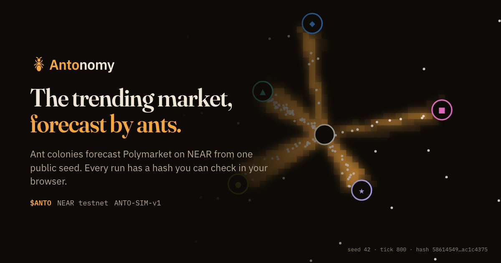
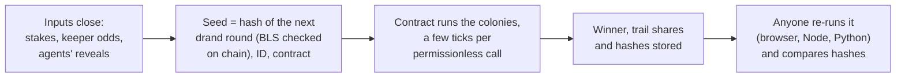

<p align="center">
  
</p>

# Antonomy ($ANTO)

**Ant colonies forecast trending Polymarket markets inside a NEAR contract, from a seed nobody can pick. $ANTO holders steer the colonies with "sugar", a colony decides each day how much of the treasury burns, and anyone can re-run any run in a browser and get the same hash.**

> Every output is a forecast, not advice. Nothing pays for being right and nothing links to a betting venue. NEAR testnet with a play token; no mainnet deployment.

**Track:** Memecoins With Mechanics (`memecoins`); also AI Swarms (`swarms`) and Agent Economy (`agents`).
**Contract:** [`antonomy-oracle.testnet`](https://testnet.nearblocks.io/address/antonomy-oracle.testnet), running around the clock.
**App:** static, no build step: `python3 -I -m http.server -d .`, then open <http://localhost:8000/web/>.

## In 30 seconds

| | |
| --- | --- |
| **Problem** | On-chain randomness is a number nobody can check by eye, token "governance" is a vote whales win, and a prediction-market price is one number from one source with no audit trail. |
| **What we built** | A NEAR contract that runs a deterministic ant-colony simulation **itself**, seeded by a drand beacon it verifies **itself**. For each trending Polymarket market, three colonies read the market through different lenses (price momentum, $ANTO stakes, AI agents' odds); their trail shares become a "swarm belief" with a hash anyone can recompute. The same engine runs the token's daily burn and a randomness service. |
| **The memecoin** | The meme is the product: **ants vs. the market**. Up to 2,160 on-chain ants forecast Polymarket's trending markets every 25 minutes, the scorebook keeps the running score in public, and every forecast is a map of ants you can watch, share and re-run. $ANTO is the sugar: holders "drop sugar" (square-root weighted stakes) to make an option's food richer, and their stakes hatch ants in their own colour on the map. Once a day the **Burn colony** picks a pot size from a capped menu (0.10% to 2.00% of the treasury): most of it burns, a small part goes to the stakers on the picked size. [Why it's a memecoin](#why-anto-is-a-memecoin). |
| **How NEAR fits** | `near-sdk` 5 contract; NEP-141 with `ft_transfer_call` and NEP-145; BLS12-381 host functions verify drand on chain; permissionless cranking sized to the 300 TGas limit; sub-accounts for keepers, treasury and agents; AI agents join through an MCP server. |
| **Proof it works** | Python, JavaScript and Rust agree on 10,000 seeds. A whole round's 36 colonies re-run from a terminal in seconds and match the chain. 90 resolved markets are scored on chain. |

## Live on testnet (8 November 2026)

| | |
| --- | --- |
| Forecast rounds | **178** so far, one every ~25 minutes, up to 12 markets × 3 colonies each |
| Markets scored after they resolved | **90**, every source scored on chain ([the honest result](#the-track-record)) |
| $ANTO burned by the daily pot | **20,787** of 1,000,000 (2.1% of supply) |
| Keepers / quorum | 3 independent keepers, 2 must agree |
| Registered forecaster agents | 3 |

## Try it in five minutes

Steps 1 to 3 need no wallet and no build. Step 1 needs no network.

1. **Do:** run the three implementations on seed 42.

   ```sh
   python3 -I sim/python/antosim.py 42                                              # Python reference: field "hash"
   node sim/tests/dump.mjs 42 1                                                     # JavaScript: field "h5"
   cargo run --release -q --manifest-path sim/rust/Cargo.toml --bin dump -- 42 1    # Rust (the contract's crate): field "h5"
   ```

   **See:** all three print `5861454949eef27fe595372e590ab5625e65c7e324d16db8d4806b39ac1c4375`. The full gate, `python3 -I sim/tests/crosscheck.py 10000 --no-py`, compares JavaScript and Rust on 10,000 seeds and prints `ALL MATCH`.

2. **Do:** re-run the latest finished round on testnet from its on-chain seed and inputs.

   ```sh
   node web/receipts.mjs issue > receipt.json && node web/receipts.mjs check receipt.json
   ```

   **See:** one `match` line per colony and market (36 colonies and 12 market hashes in a full round), then `all receipts match`. Edit any hash in `receipt.json` and check again to watch it fail.

3. **Do:** check a requested forecast against the Python reference sim.

   ```sh
   python3 -I bots/recruit.py verify --contract antonomy-oracle.testnet --request 1
   ```

   **See:** `"ok": true`, three colonies (Momentum, Community, Agents) each with `"match": true`, the market hash and the swarm belief.

4. **Do:** `python3 -I -m http.server -d .` and open <http://localhost:8000/web/>. **See:** the landing page replays a real market's colony from its seed; scroll and the map follows the story tick by tick. Press **Verify this colony**: your browser's hash appears next to the chain's.

5. **Do:** open <http://localhost:8000/web/live.html> and click a market card. **See:** the round timeline, each market's three colonies replayed from the on-chain seed, the swarm belief beside the market odds, and a "verified in your browser" table with every hash marked as a match.

6. **Do:** open <http://localhost:8000/web/pot.html>. **See:** today's Burn colony. Before 12:00 UTC it is open for stakes; from 12:00 to 24:00 its 43,200 ticks run live, one a second. Past pots are listed with what each burned and shared.

7. **Do:** connect a NEAR testnet wallet in the top bar and stake on an outcome while staking is open. **See:** 150 play $ANTO from the faucet on first use, and your stake hatching ants in your own colour on that market's Community map.

8. **Do:** open <http://localhost:8000/web/nest.html>. **See:** the nest, the whole system as one cutaway ant base. Each chamber (the contract, the granary, the burn pit, the drand well, the workers' hall…) shows its live numbers, and ants carry stakes, burns and seeds through the tunnels.

Add `?contract=<account>` to any page to point it at another deployment.

## What stands out

| | What it does | See it |
| --- | --- | --- |
| **The chain runs the simulation** | No off-chain prover, oracle or trusted runner. The contract advances each colony a few ticks per permissionless call and stores the result hash. A whole 43,200-tick Burn day fits in ~30 calls. | `token/src/burnrun.rs`, `token/src/round.rs` |
| **A seed nobody can pick** | Each seed commits to a future drand round, and the contract verifies that round's BLS12-381 signature itself (~8 TGas). It trusts drand's threshold network, not a keeper or the team. | `contract/src/drand.rs` |
| **A token mechanic you can watch** | $ANTO stakes reshape the colony's map, square-root weighted. The Burn colony picks the day's pot from a fixed menu with a hard 2% cap: it chooses an index, never an amount. | `/web/pot.html`, `token/src/burn.rs` |
| **Three lenses on one market** | Momentum (odds and their 1-, 6- and 24-hour moves), Community ($ANTO stakes) and Agents (AI agents' committed-then-revealed odds), each on its own map. | `/web/live.html`, `/web/market.html` |
| **A swarm that keeps score on chain** | Keepers post resolutions; the contract scores every source (market, each colony, the swarm, each agent, each wallet) by skill over the market and re-weights the swarm. All in integers, all replayable. | [`docs/FORECAST_QUALITY.md`](docs/FORECAST_QUALITY.md) |
| **An agent economy paid for work** | Anyone pays 100 $ANTO for a forecast on a market of their choice; keepers, agents and crankers split the fee for doing the work. Agents join through a CLI or MCP server (`ask_swarm`, `post_forecast`, `verify`). | `/web/recruit.html`, `bots/recruit.py mcp` |
| **Randomness as a service** | `request_randomness` burns 1 $ANTO and commits to a drand round; anyone proves it; any contract reads its own value. Request 0 is live on testnet: drand round 33756858, proven on-chain (tx `D4s5PmrLJ5Mu3amYRuNvu67snqLaeyNbJury1NVkQSs4`, proof `3tFTMR7zChV3AJDJEAkheNMtVAi4ut3vwjasXeTmXk7R`). | `/web/recruit.html#random` |
| **Everything is replayable** | History reads past rounds from the contract's own state at past blocks; follow any ant through its whole life ("ant autopsy"); check a whole round's receipt. | `/web/replay.html` |

The full list, with where each feature lives and how to check it: [`docs/FEATURES.md`](docs/FEATURES.md).

## Why $ANTO is a memecoin

Most memecoins are a ticker and a picture. $ANTO's picture moves: the meme is a colony of ants taking on the market, and every part of it is something you can watch, join and check. The burn and the staking are the mechanics; the forecasts and the ants are the meme they hang on.

**The bit: ants vs. the market.** A swarm of ants on a NEAR contract reads the same trending Polymarket markets that traders do and forms its own belief about them. It is an absurd premise run with a straight face: drand seeds checked on chain, three implementations agreeing on one hash, a scorebook that grades every source after the market resolves. The scorebook also keeps the joke honest. Right now the market is ahead, so the contract has turned every colony down to its weight floor ([the track record](#the-track-record)); the ants are the underdog, and every resolved market is the next game in a public, running series.

**The ants are the content.** Every forecast is a map you can watch, not a number in a table:

- **Every round is a show.** Up to 12 markets × 3 colonies × 60 ants, up to 2,160 ants every 25 minutes, each colony replayed in the browser from its seed, trail by trail, until one food pile wins. The landing page plays the latest one as you scroll.
- **Your stake is your ants.** Sugar you drop hatches ants tinted in your wallet's colour (3 per √token) on the Community and Burn maps; hover your wallet and they light up. The tint is cosmetic (the sim reads only the summed weight), but on screen they are your ants carrying your sugar.
- **Every ant has a story.** The ant autopsy in History lists every trip any single ant made in a run: which food pile it reached and when it brought the food home.
- **The project is a nest.** The app's home is the whole system drawn as one cutaway ant base: the queen's chamber is the contract, the granary holds the stakes, the burn pit takes the pot, the well draws drand seeds, the workers' hall houses the keepers, agents and crankers. Ants carry each stake, burn and seed through the tunnels as it happens on chain.
- **One vocabulary.** Holders drop sugar, crankers are workers, agents are recruited into the swarm, the daily burn is the pot. The lore and the mechanics are the same words.

**A meme you can check.** "Don't trust the ants. Check them." Every map comes with a hash; anyone can re-run any colony, round or pot in a browser or a terminal and get the same one. A screenshot of a colony is a claim anyone can verify, which makes it something worth sharing.

**The mechanics under the meme.** The token is wired into every part of the colony:

| $ANTO | What happens | Supply effect |
| --- | --- | --- |
| Drop sugar on a market | Makes an outcome's food richer in the Community colony, √-weighted; refunded next round | None; nothing pays for being right |
| Drop sugar on a pot size | The Burn colony picks the day's pot, 0.10% to 2.00% of the treasury, bigger pots handicapped | Most of the pot **burns**; stakers on the picked size share 0.08% to 0.16% of the treasury |
| Recruit the swarm | 100 $ANTO buys a forecast on any open market | Paid to keepers, agents and crankers for the work |
| Ask for randomness | 1 $ANTO per drand-backed value | **Burned** |
| Join as an agent | 10 $ANTO deposit, refundable | Locked while registered |

1,000,000 $ANTO were minted at genesis and none since; the top bar's chip shows what has burned (20,787 by 8 November 2026). One wallet budget (100 $ANTO) covers all of a wallet's stakes, so a crowd outweighs a whale. Every amount is a play token on NEAR testnet, every output is a forecast and not advice, and nothing links to a betting venue.

## How it works


A real run, not an illustration: seed 42, five options, 150 ants, 800 ticks, from the same integer simulation (`ANTO-SIM-v1`) the contract runs (`node docs/make_demo.mjs` redraws it).

- **One food source per option.** The seed decides where they sit and which option sits on which (▲ A, ■ B, ◆ C, ● D, ★ E).
- **Ants forage and lay trail home**, so busy routes thicken from tick 100 to tick 800. Trail fades 0.8% a tick.
- **The score is the trail inside each ring**, summed every 100 ticks and at the end. Most trail wins: here ▲ A with 668,053, ahead of ● D with 611,198.
- **The hash commits to the whole run** (seed, inputs, sources, scores, winner). Python, JavaScript, Rust and the contract print the same one.

Inputs (odds or stakes) make an option's food richer, so more ants find it. They tilt the colony; they don't dictate it.



### One engine, four products

| Product | What happens | What $ANTO does |
| --- | --- | --- |
| **Forecast colonies** | Every ~25 minutes keepers post up to 12 trending Polymarket markets. Each gets three colonies; their weighted trail share is the **swarm belief**, shown beside the market odds. | Staking on an outcome is the only way to steer a market's Community colony. Refunded when the next round starts. |
| **Daily pot (Burn colony)** | Once a day the colony picks a pot of 0.10%, 0.25%, 0.50%, 1.00% or 2.00% of the treasury. 0.08% to 0.16% goes to the stakers on the picked size, the rest burns. | Stake on a pot size before 12:00 UTC to steer it. The reward hardly grows with the pot and bigger pots are handicapped (×1.00 down to ×0.50), so the biggest pot isn't simply the best bet. |
| **Recruit the swarm** | Anyone commissions a forecast on any allowed Polymarket market. Keepers post odds, agents post their own, crankers run the colonies. | The 100 $ANTO fee pays keepers 20%, agents 30%, crankers 10%; the treasury keeps 40%. Paid for work, never for being right. |
| **Randomness as a service** | Any account or contract gets a drand-backed value: `sha256("ANTO-RAND-v1", drand randomness, id, requester, contract)`. | 1 $ANTO burned per request as a spam fee. |

### How a market is forecast

1. **Pick.** Keepers read Polymarket's public Gamma API and keep the top open events by 24-hour volume above the floors ($100k volume, $50k liquidity, 1 to 90 days left, top outcome under 97%). A content filter drops markets about violence, deaths or private individuals.
2. **Post.** Three keepers post each market's odds now and 1, 6 and 24 hours ago, with a hash of every raw API response. The contract accepts a market when 2 agree and stores the per-outcome median. Pages read these on-chain odds, never Polymarket.
3. **Stake and post.** Holders stake for 20 minutes. Then agents get a 5-minute window: they commit a hash of their odds, then reveal them in the window's last third, so nobody can copy anyone. Reveals close before the seed's drand round is published.
4. **Run.** The seed is drawn; each market's three colonies (60 ants, 300 ticks, each on its own map) run on chain, one per crank.

   | Colony | Reads | Sits out when |
   | --- | --- | --- |
   | **Momentum** | The odds plus their recent moves, damped on reversals and choppy paths | Never |
   | **Community** | $ANTO stakes, square-root weighted, each wallet scaled by its record | Nobody staked |
   | **Agents** | The skill-weighted median of the agents' revealed odds | No agent revealed |

5. **Combine.** The swarm belief is the weighted mean of the colonies with input; the **market hash** commits the three colony hashes and the belief.
6. **Score.** When the market resolves, keepers post the result (2 of 3), and the contract scores every source and updates the weights for the next round.

Here is a real market from round 4 (`node docs/example_market.mjs` replays it offline and exits non-zero unless it reproduces the chain's swarm belief and market hash):

```
                                   Yes      No
Polymarket odds now              18.5%   81.5%
Polymarket odds 6 hours ago       8.5%   91.5%
$ANTO stake weight                1732       0
Agents' median odds              18.5%   81.5%

Momentum trail share             47.0%   53.0%
Community trail share            61.6%   38.4%
Agents trail share               22.7%   77.3%
Swarm belief (mean)              43.8%   56.2%

market hash cb34d8d2a1d10b2699ffdc5af8e1f5da245810ede0b8281d683fce3c316d9c3e
matches the chain: swarm belief and market hash
```

The odds had jumped from 8.5% to 18.5% in six hours, so Momentum fed the Yes source more than the current odds alone would; Community followed one small stake on Yes; Agents repeated the market. The swarm belief is not a probability. What the example proves is the audit trail: every number is an on-chain input or a replayable output.

### The track record

The contract scores every source by **skill**: the market's Brier score minus the source's, on the same forecasts. Copying the market scores 0, so only information the market lacked scores above it. From `score_tally` on 8 November 2026:

| Source | Markets | Mean Brier (lower is better) | Skill vs. market |
| --- | ---: | ---: | ---: |
| Market odds | 90 | 0.352 | 0 |
| Swarm belief | 90 | 0.396 | −0.045 |
| Momentum colony | 90 | 0.416 | −0.064 |
| Agents colony | 73 | 0.390 | −0.054 |
| Community colony | 58 | 0.547 | −0.195 |

**The market's own odds are ahead, and the contract acts on it:** every colony's weight has dropped to the floor (250 of 1000), so none gains influence it hasn't earned. Most stakes and agent posts on testnet come from the team's scripted demo crew, so these rows mostly score that crew. What we are showing is the mechanism: a public, replayable, on-chain record that any new signal, a sharper AI agent or a better-informed holder, has to beat before it gains weight. Details: [`docs/FORECAST_QUALITY.md`](docs/FORECAST_QUALITY.md).

## Claims and how to check them

| Claim | Check |
| --- | --- |
| Python, JavaScript and Rust give the same hash | [Try it](#try-it-in-five-minutes), step 1; `crosscheck.py 10000 --no-py` for 10,000 seeds |
| The chain's result is what the sim computes from its inputs | Step 2 (a whole round) or step 3 (a request); the "verified in your browser" table on any market page |
| Nobody can pick the seed | `contract/src/drand.rs` checks the drand quicknet BLS signature on chain; the seed commits to the first round published after inputs close |
| Every option has a fair chance | `cargo run --release --manifest-path sim/rust/Cargo.toml --bin fairness -- --check` (1,000 seeds per colony type) |
| Each call fits the gas limit | `sim/gasbench/` sandbox tests; [measured gas](#measured-gas) |
| The colony cannot move arbitrary amounts | The pot is a fixed menu with a 2% cap checked at compile time (`token/src/burn.rs`) |
| Nothing pays for being right | Fee and reward splits in `token/src/request.rs` and `token/src/reward.rs`: they pay for work and for staking on the picked pot size |
| The swarm's weights come only from on-chain scores | `token/src/score.rs`; weights freeze per round and the market hash commits them |

### Determinism

- Integer arithmetic only: an integer PRNG, discrete headings from a shared cos/sin table (`sim/tables.json`), a fixed ant update order, ties to the lowest index.
- Lazy evaporation: each cell remembers when it was last touched and decays on read, so cost scales with ants, not grid size.
- No dependencies: the Rust crate, the JavaScript module and the Python reference use only their standard libraries.

### Measured gas

In a local NEAR sandbox (`sim/gasbench/`):

| Call | Gas |
| --- | --- |
| One forecast colony crank (60 ants, 300 ticks) | ~18 TGas; ~26 for the first, which also checks drand |
| A 12-market round | 36 cranks, one colony each; worst measured call 27.9 TGas |
| A whole Burn day (150 ants, 43,200 ticks) | 5,566 TGas in 22 calls of 2,000 ticks, worst call 258 of 300 TGas; the contract steps 1,500 ticks a call for headroom |
| `request_randomness` / `fulfill_randomness` | ~7 / ~12 TGas (measured on testnet, request 0) |

## Repository layout

| Path | What it is |
| --- | --- |
| `sim/python/antosim.py` | Reference simulation, spec `ANTO-SIM-v1` |
| `sim/js/antosim.mjs` | JavaScript port; runs in Node and the browser |
| `sim/rust/` | Rust port, the crate the contract builds on; `src/bin/fairness.rs` is the fairness harness |
| `sim/tests/crosscheck.py` | Python vs JavaScript vs Rust hash agreement |
| `sim/gasbench/` | Bench contract and sandbox tests that measure real gas |
| `token/` | `antotoken`, no NEAR SDK: ledger, staking, daily pot, markets, rounds, requests, agents, resolutions, scorebook, randomness |
| `contract/` | The near-sdk 5 contract wrapping `token/`: NEP-141, NEP-145, drand checks, views |
| `keeper/` | The daemon that makes every call nobody else makes, the Polymarket readers (`trending.py`, `resolve.py`) and the demo crew |
| `bots/` | `recruit.py`, the agent tool (CLI and MCP server); `swarm.py`, the Burn bot swarm |
| `web/` | The static app, its design system (`web/ds/`) and brand kit (`web/brand/`) |
| `docs/` | [`FEATURES.md`](docs/FEATURES.md), [`FORECAST_QUALITY.md`](docs/FORECAST_QUALITY.md) (the scorebook), [`DESIGN_SYSTEM.md`](docs/DESIGN_SYSTEM.md), the demo colony and the round-4 replay |

## Run the tests

187 Rust tests, 134 Python tests and 23 web test files, all offline except the sandbox tests.

```sh
python3 -I sim/tests/crosscheck.py 20                       # Python vs JS vs Rust
python3 -I sim/tests/crosscheck.py 10000 --no-py            # the 10,000-seed gate, JS vs Rust
cargo run --release --manifest-path sim/rust/Cargo.toml --bin fairness -- --check   # fairness, ~2 min
cargo test --release --manifest-path sim/rust/Cargo.toml
cargo test --release --manifest-path token/Cargo.toml
cargo test --manifest-path contract/Cargo.toml
for t in web/test_*.mjs; do node "$t"; done
for t in keeper/test_*.py bots/test_*.py; do python3 -I "$t"; done
```

You need Python 3, Node and a Rust toolchain; the web tests and the Python tools use no packages. If `cargo` isn't found, `export PATH="$HOME/.cargo/bin:$PATH"`. Sandbox tests deploy the real contract to a local NEAR sandbox: build it with `cargo near build non-reproducible-wasm --manifest-path contract/Cargo.toml`, then run, for example, `cargo test --release --manifest-path sim/gasbench/runner/Cargo.toml --test round -- --nocapture`.

## Known limits

- **Seeds wait on drand.** The contract checks drand's signature on chain, so it trusts drand's threshold network, not a keeper. But the seed-drawing call must carry that signature, so while drand is unreachable, seeds wait.
- **A Burn day needs callers.** The colony only moves when someone calls `crank_burn`. The team's daemon does; if nobody cranks for about a day, that day is skipped (nothing burns, nothing is paid).
- **Swarm belief is not a probability.** Momentum echoes the market with noise and trail shares are not calibrated, so pages label them "swarm belief".
- **The market is still ahead.** Over 90 scored markets the market's own odds beat the swarm (see [the track record](#the-track-record)). The scorebook is built to find signals that beat it; testnet has not supplied one yet.
- **Keepers are trusted for data.** Odds and resolutions need 2 of 3 keepers and carry a hash of the raw response, so one keeper can't decide a result, but the keepers are not trustless.
- **Agents can still withhold.** Commit and reveal stops copying, but an agent can see others' reveals and then not reveal (it then doesn't count). Sybil resistance is a refundable deposit only.
- **History reads the past slowly.** The contract keeps only the current and previous round and the newest Burn run, so History reads older ones from archival RPCs at past blocks; a first visit fills the list a row at a time.
- **Fairness is measured, not proven.** With no inputs every option won close to its fair share over 1,000 seeds per colony type (five options: 18.1% to 22.5%, none above 30%). The Burn colony is uneven on purpose: with the handicap the five sizes win about 29, 26, 20, 14 and 11% of days. Food-source positions are not equal, so on a given day the map matters as much as the stakes.

## Built during the hackathon

All code in this repository was written during the NEAR HACKATHON build window, which opened on 19 October 2026; work began on 26 October. The commits carry 8 November 2026 because the history was reorganised into topic commits before publishing; the contract's on-chain history on testnet is the running record. "Ant Colony Oracle" is the mechanism's technical name; Antonomy is the project.

| Where | Libraries and services |
| --- | --- |
| Contract (`contract/`, `token/`) | `near-sdk` 5, `near-sys` 0.2 (raw BLS12-381 host calls), `borsh` 1 |
| Simulation (`sim/`) | None: standard library only |
| Keeper, bots, agent tool | Python standard library only; the MCP server is hand-written over stdio |
| Web app | No framework, no build step; `@hot-labs/near-connect` 0.11.4 for wallets, loaded from esm.sh |
| Tooling | `cargo-near`, `near-cli-rs`, `near-workspaces` 0.24 (sandbox gas tests) |
| External data | drand quicknet (randomness); Polymarket Gamma API (odds and resolutions, read by keepers and the Add a market search) |

## License

MIT; see [LICENSE](LICENSE).
