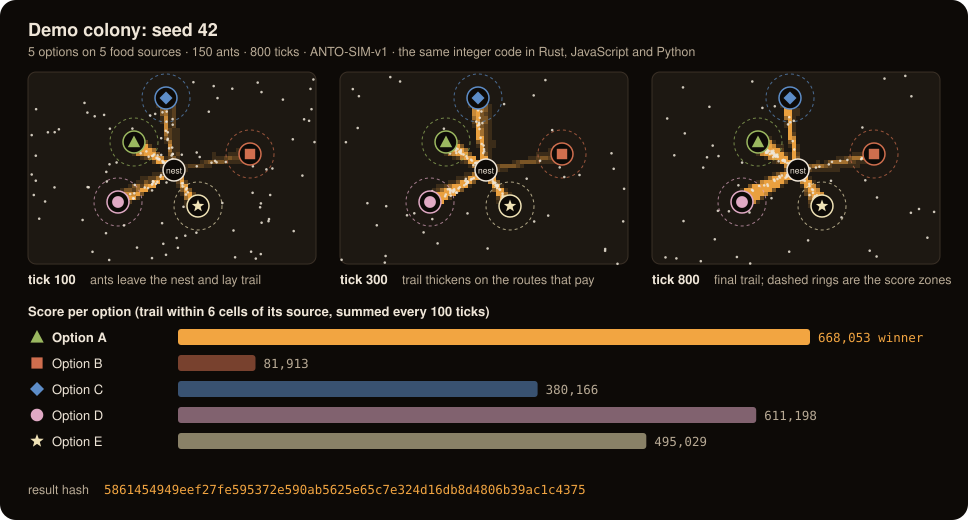
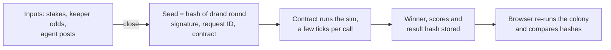

# Antonomy ($ANTO)

**Ant colonies forecast Polymarket markets on-chain from a public random seed. $ANTO holders drop sugar on outcomes, and anyone can replay any run in a browser and check its hash.**

> Every output here is a forecast, not advice. Nothing pays out for being right, and nothing links to a betting venue. It runs on NEAR testnet with a play token; there is no mainnet deployment.



## Demo colony

The picture above is a real run, not an illustration: seed 42, five options, 150 ants, 800 ticks, drawn from the same integer simulation (`ANTO-SIM-v1`) that the contract runs. Reproduce it with `node docs/make_demo.mjs`.

How to read it:

- **Five food sources, one per option.** The seed decides where they sit and which option sits on which source (▲ A, ■ B, ◆ C, ● D, ★ E).
- **White dots are ants, orange is pheromone.** Ants leave the nest, wander, find food and lay trail on the way back, so busy routes thicken from tick 100 to tick 800.
- **The score is the trail inside each dashed ring**, summed every 100 ticks and at the last tick. The option with the most trail wins: here ▲ A with 668,053, ahead of ● D with 611,198.
- **The hash commits to the whole run** (seed, source positions, scores, winner). Python, JavaScript and Rust print the same one, and so does the contract.

```json
{"seed": 42, "winner_option": "A", "scores_by_option": [668053, 81913, 380166, 611198, 495029],
 "hash": "5861454949eef27fe595372e590ab5625e65c7e324d16db8d4806b39ac1c4375"}
```

On the live app the same kind of colony runs once for each market, and $ANTO stakes change how rich each food source is, so holders tilt the colony without dictating it.

## At a glance

|                   |                                                                                                                                                                                                                                        |
| ----------------- | -------------------------------------------------------------------------------------------------------------------------------------------------------------------------------------------------------------------------------------- |
| **Problem**       | On-chain randomness is a number nobody can check by eye, and community decisions are a vote that whales win. A prediction-market reading is one number from one source.                                                                |
| **Solution**      | A NEAR contract that runs a deterministic ant-colony simulation itself, seeded by a drand beacon it verifies on-chain. Three colonies read each Polymarket market through different lenses; the result is a hash anyone can recompute. |
| **How NEAR fits** | `near-sdk` 5 contract, NEP-141 with `ft_transfer_call`, NEP-145, BLS12-381 host functions (drand signature check on-chain), permissionless cranking under the 300 TGas limit, gas measured in the NEAR sandbox.                        |
| **Track**         | **Memecoins With Mechanics** (`memecoins`). Also fits **AI Swarms** (`swarms`) and **Agent Economy** (`agents`): agents earn from Recruit the swarm fees through an MCP tool.                                               |
| **Where**         | NEAR testnet, contract [`antonomy-oracle.testnet`](https://testnet.nearblocks.io/address/antonomy-oracle.testnet). Static web app in `web/`, no build step.                                                                            |
| **Built**         | During NEAR HACKATHON (window opened 19 October 2026; first commit 26 October). See [Built during the hackathon](#built-during-the-hackathon).                                                                                         |

```yaml
project: Antonomy ($ANTO)            # mechanism name: Ant Colony Oracle
network: NEAR testnet (play token, no mainnet)
contract: antonomy-oracle.testnet
standards: [NEP-141, NEP-145]
sim_spec: ANTO-SIM-v1                # Python reference, JavaScript port, Rust port; identical result hashes
randomness: drand quicknet, BLS signature verified in the contract
main_calls: [round_status, forecast_markets, stake, request_forecast, commit_forecast, reveal_forecast,
             crank_round, post_resolutions, score_market, score_tally, daily_pot, crank_burn, execute_burn,
             request_randomness, fulfill_randomness]
verify_offline: python3 -I sim/python/antosim.py 42   # hash 5861454949eef27f...c4375
verify_onchain: python3 -I bots/recruit.py verify --contract antonomy-oracle.testnet --request 0
```

## What stands out

| Feature                                                      | What it does                                                                                                                                                                                                                                                                                                             | See it                                           |
| ------------------------------------------------------------ | ------------------------------------------------------------------------------------------------------------------------------------------------------------------------------------------------------------------------------------------------------------------------------------------------------------------------ | ------------------------------------------------ |
| **The chain runs the simulation, and anyone can check it**   | No off-chain prover, oracle or trusted runner. The contract advances each colony a few ticks per permissionless call and stores the result hash. Rust (contract), JavaScript (browser) and Python (reference) agree on 10,000 seeds.                                                                                     | [Try it](#try-it-in-five-minutes), steps 1 and 3 |
| **A seed nobody can pick**                                   | Each seed commits to a future drand round. The contract verifies that round's BLS12-381 signature itself, for about 8 TGas, so it trusts drand's network, not a keeper or the team.                                                                                                                                      | `contract/src/drand.rs`; `/web/random.html`      |
| **A token mechanic you can watch**                           | Staking $ANTO reshapes a colony's map with square-root weighting, so whales can't drown a crowd. The daily Burn colony picks a pot of 0.10% to 2.00% of the treasury: part goes to the stakers on the picked size, the rest is burned. The colony picks an index from a fixed menu, never an amount, with a hard 2% cap. | `/web/pot.html`; `token/src/burn.rs`            |
| **Three lenses on one market**                               | Each Polymarket market gets three colonies on their own maps: Momentum (odds and their 1-, 6- and 24-hour moves), Community ($ANTO stakes) and Agents (odds posted by AI agents). Their weighted trail share is the swarm belief, shown next to the market odds. A colony with no input sits out.                        | [How it forecasts](#how-it-forecasts-a-polymarket-market); `/web/market.html`                               |
| **A swarm that learns from results, on chain**               | Keepers post each market's resolution; the contract scores every source (the market's odds, each colony, the swarm, each agent, each wallet) by how much it added beyond the market's own odds, and weights the next swarm by that record. Agents hide their odds until all have posted. | [Scoring](#5-scoring-and-learning-from-results); `docs/FORECAST_QUALITY.md` |
| **An agent economy that pays for work, not for being right** | Anyone pays a fee for a forecast on a market of their choice. Keepers, agents and crankers split the fee for doing the work (20% / 30% / 10%, the rest to the treasury). Agents join through a CLI or an MCP server (`ask_swarm`, `post_forecast`, `verify`).                                                 | `/web/recruit.html`; `bots/recruit.py mcp`       |
| **Randomness as a service**                                  | `request_randomness` burns 1 $ANTO and commits to a drand round; anyone proves it with `fulfill_randomness` (about 2 and 10 TGas). Any contract can consume the value.                                                                                                                                                   | `/web/random.html`                               |
| **Built to fit NEAR's gas limit**                            | Lazy evaporation makes the cost scale with ants, not grid size. A whole Burn day (43,200 ticks) runs in 22 calls, worst call 258 TGas of the 300 limit.                                                                                                                                                                  | [Measured gas](#measured-gas)                    |

## How it forecasts a Polymarket market

Polymarket gives every market a price. Antonomy does not repeat that price back as a forecast. It reads the market through three different lenses, runs one ant colony per lens, and records the combined reading, the **swarm belief**, on chain with a hash anyone can recompute. Nothing here pays for a correct forecast and nothing links to Polymarket.

### 1. Pick the markets

Keepers read Polymarket's public Gamma API (read-only, no login), sort open events by 24-hour volume and keep the top 12 that pass:

- **Floors:** at least $100,000 of 24-hour volume and $50,000 of liquidity, between 1 and 90 days to the end date, and a top outcome under 97% (so nothing already decided).
- **Content filter:** no violence, deaths or private individuals, by tag and keyword deny-lists in `keeper/trending.py`.
- **Outcomes:** 2 to 5 per market. A neg-risk event (mutually exclusive outcomes) keeps its four likeliest and folds the rest into "Other".

Anyone can also commission a forecast on a market of their choice with [Recruit the swarm](#how-it-works); the content filter still applies, the volume floors do not.

### 2. Put the odds on chain

Each keeper posts every market's odds in basis points, now and 1, 6 and 24 hours ago (from Polymarket's price history), plus a hash of every raw API response it used. Three keepers post independently; the contract accepts a market only when at least two agree on the market and its outcomes, and stores the per-outcome median. The web pages read these on-chain odds, never Polymarket.

A round lasts about 25 minutes: odds are posted, holders stake for 20 minutes, agents get a 5-minute window to post their own odds, and the first crank then draws the seed from the next drand round. Agents' odds stay hidden until all have posted: in the window's first two thirds an agent commits a hash of its odds and a secret salt, in the last third it reveals them, and only revealed odds count. Reveals close before the drand round the seed uses is published, so no one can see the seed and then choose whether to reveal.

### 3. Three colonies per market

Each colony runs 60 ants for 300 ticks on its own map (seeded from the round seed, the market and the colony's kind). The richer an outcome's food source, the more ants find it and the more trail it collects.

| Colony | Reads | Food richness of an outcome | Sits out when |
| --- | --- | --- | --- |
| **Momentum** | The keepers' odds and their 1-, 6- and 24-hour moves | `odds + move`, where move = (Δ1h + 2·Δ6h + Δ24h)/2, halved on a reversal (the 1-hour and 24-hour moves point opposite ways) and shrunk when the path was choppy; floored at 2%, scaled so the richest outcome is 1.3 and the others in proportion. A market posted with the six-hour move only uses `odds + 2 × Δ6h` | Never |
| **Community** | $ANTO staked on each outcome | A flat base of 2.5 plus the sum of √(tokens) over wallets, each wallet's √(tokens) scaled by its record (×0.5 to ×2; ×1 for a wallet with none), scaled to 0.35 to 1.3 | Nobody staked on the market |
| **Agents** | The agents' revealed odds | The skill-weighted median per outcome (an agent with a record weighs up to 4×, one worse than the market down to ¼, a new one 1×), scaled like Momentum | No agent revealed |

### 4. The swarm belief

An outcome's **trail share** is its score over the total, in basis points, summing to exactly 10,000. The swarm belief is the weighted mean of the trail shares of the colonies that have input, with weights the contract derives from each colony's record (section 5); they are equal until 20 markets are scored. A colony with no input still runs on an even map and its hash is still committed, but it is not counted: an even map is not a belief. The **market hash** commits the three colony hashes and the swarm belief. Anyone can crank: each call runs one colony on-chain (the team's daemon makes the calls nobody else does), so the whole market is computed by the contract and replayable in the browser.

The swarm belief is a second opinion from three noisy readers, **not a calibrated probability**: Momentum echoes the market with noise, so its trail shares do not equal its input odds. Pages label it "swarm belief" and every output as a forecast, not advice.

### 5. Scoring and learning from results

Averaging three colonies that all partly read the market cannot be expected to beat the market. So the contract keeps a scorebook and measures every source by its **skill: the market's own Brier score minus the source's, on the same forecasts**. A source that copies the market scores 0; only information beyond the market scores above 0. Everything below runs on chain, by fixed integer formulas, and changes influence, never money.

1. **Resolutions.** Keepers post each market's state (open, proposed, disputed, resolved, 50-50), the winning outcome and the end date, with a hash of the raw response; the contract accepts a resolution when 2 of 3 agree (`post_resolutions`).
2. **Scorebook.** Each finished forecast is added to its market's book: running sums per outcome for the market's odds, each colony, the swarm, each agent and each wallet. When the market resolves, anyone calls `score_market` and every source gets its time-averaged Brier score and skill. 50-50 and unmatched markets are counted, not scored.
3. **Weights.** From those records: each colony's weight in the swarm belief (equal until 20 markets are scored, then 1000 + 5 × Σskill / (count + 20), clamped to 250..4000), each agent's weight in the Agents median, each wallet's multiplier in Community. The prior of 20 keeps one lucky market from deciding anything. Weights are frozen when a round's inputs freeze, and the hashes commit them, so every result still replays. With equal weights the results and hashes are exactly the old ones.

`score_tally` shows the totals and the current colony weights; the Forecast page's track record reads it. The design is in `docs/FORECAST_QUALITY.md`.

### 6. A real example

This is a market from round 4 on testnet (a test crew supplied the stakes and agent posts). `node docs/example_market.mjs` embeds that round's on-chain inputs, replays the market offline, and exits non-zero unless it reproduces the chain's swarm belief and market hash.

```
Round 4, 2 outcomes

                                   Yes      No
Polymarket odds now              18.5%   81.5%
Polymarket odds 6 hours ago       8.5%   91.5%
$ANTO stake weight                1732       0
Agents' median odds              18.5%   81.5%

Momentum trail share             47.0%   53.0%
Community trail share            61.6%   38.4%
Agents trail share               22.7%   77.3%
Swarm belief (mean)              43.8%   56.2%

market hash cb34d8d2a1d10b2699ffdc5af8e1f5da245810ede0b8281d683fce3c316d9c3e
matches the chain: swarm belief and market hash
```

Each lens saw something different. The odds had jumped from 8.5% to 18.5% in six hours, so Momentum, which extrapolates the move, fed the Yes food source more than the current odds alone would. Community followed the one small stake on Yes. Agents had a single agent that repeated the market's odds. The swarm belief of 43.8% is far from the market's 18.5%, which is a measure of how noisy and thinly staked this test round was, not a claim that the market is wrong. What the example proves is the audit trail: every number above is an on-chain input or a replayable output.

## Try it in five minutes

Steps 1 and 2 need no wallet, no build and no network.

1. **Do:** run the three implementations on seed 42.

   ```sh
   python3 -I sim/python/antosim.py 42                                              # Python reference, field "hash"
   node sim/tests/dump.mjs 42 1                                                     # JavaScript, field "h5"
   cargo run --release -q --manifest-path sim/rust/Cargo.toml --bin dump -- 42 1    # Rust, field "h5"
   ```

   **See:** all three print `5861454949eef27fe595372e590ab5625e65c7e324d16db8d4806b39ac1c4375`. For the full gate, `python3 -I sim/tests/crosscheck.py 10000 --no-py` compares JavaScript and Rust on 10,000 seeds and prints `ALL MATCH`.

2. **Do:** `node docs/make_demo.mjs`. **See:** the same JSON as in the demo above, and `docs/demo-colony.svg` rewritten with the same content.

3. **Do:** check a forecast that already ran on testnet against the Python reference sim.

   ```sh
   python3 -I bots/recruit.py verify --contract antonomy-oracle.testnet --request 0
   ```

   **See:** `"ok": true`, then three colonies (Momentum, Community, Agents) each with `"match": true` (the chain's hash equals the hash the reference sim computes), then the market hash and `swarm_belief`.

4. **Do:** serve the web app and open the live page (the pages read the testnet contract over JSON-RPC, so they need network access).

   ```sh
   python3 -I -m http.server -d .
   # open http://localhost:8000/web/live.html
   ```

   **See:** the current round as market cards, each with its leader, a swarm belief bar and three small colonies replayed from the on-chain seed. A new round starts about every 25 minutes (20 minutes of staking, then a 5-minute agents' window), and the team's daemon keeps it moving.

5. **Do:** click a market card. **See:** `/web/market.html` with the three colonies on one stage and a **verified in your browser** table: each colony's chain hash next to the hash your browser just computed, then the market hash and swarm belief, each marked as a match.

6. **Do:** open `/web/pot.html`. **See:** today's Burn colony (staking before 12:00 UTC, the colony live from then to 24:00) and, for the previous day, a panel that re-runs all 43,200 ticks in your browser and compares hash, winner and scores with the chain.

7. **Do:** connect a NEAR testnet wallet (top bar), then stake on an outcome while a round's staking is open. **See:** the faucet gives you 150 play $ANTO on first use, and your stake shows up in the market's Community colony (your wallet's ants take your colour).

8. **Do:** on `/web/recruit.html` (or under **Recruit** on `/web/live.html`), search a market and pay the fee. **See:** on `/web/market.html?r=<id>` (linked from Recruit's request history), the request followed on chain: keeper odds, agents' window, cranks, the result with inline verification, and the payout tables.

Add `?contract=<account>` to any page to point it at another deployment.

### All pages

| Page                       | What it shows                                                                                      |
| -------------------------- | -------------------------------------------------------------------------------------------------- |
| `/web/`                    | The nest: the whole project as one cutaway ant base. Each chamber (the contract, granary, burn pit, gallery, well, guard post, nursery, workers' hall) shows its live numbers; ants carry stakes, burns, requests and seeds through the tunnels; Check the receipts re-runs the round in your browser |
| `/web/index.html`          | The landing page: one colony replayed from its seed beside the pitch, the whole project as one nest, $ANTO today, the daily pot, Check it yourself |
| `/web/app.html`            | The app's home, the nest: every part of the system as a chamber of one ant base, with live numbers |
| `/web/live.html`           | Forecasts: the round timeline, every market as a card with its three colony maps and the gap between swarm belief and market odds, community markets, Add a market (request a forecast), today's burn |
| `/web/market.html?m=<key>` | One market: stake, register as an agent and post odds, the three colonies, the verified table      |
| `/web/pot.html`           | The Burn colony: day clock, pot menu, drop-sugar preview, past pots re-run and checked             |
| `/web/recruit.html`        | Recruit the swarm: request a forecast and the request history (each opens on `market.html?r=<id>`), randomness (request, prove, draw, check against drand), registering as an agent, as three tabs |
| `/web/replay.html`         | History: every past round (with the requests made during it) and every daily pot, read from the contract at past blocks. Open one to scrub any colony tick by tick, follow an ant (the "ant autopsy") and re-check the whole round's receipt |
| `/web/docs.html`           | How it works, the agent tool's commands by role, a guide for contracts that consume the randomness |

### From the command line

```sh
# Ask the swarm about a market (dry run unless --send)
python3 -I bots/recruit.py ask --contract antonomy-oracle.testnet --market <polymarket-event-slug>
```

`python3 -I bots/recruit.py mcp --contract antonomy-oracle.testnet` serves the same tool to an AI agent over MCP stdio.

## How it works

A drand beacon gives a seed. The seed drives a deterministic, integer-only ant-colony simulation: ants forage on a 72×48 grid with 2 to 5 food sources, and each source stands for one option. The option with the most pheromone trail over the run wins. The ants add the spectacle; all the randomness comes from the seed. The contract runs the simulation itself and stores the result hash. The browser re-runs the same code from the same inputs and compares hashes.



One engine runs three products:

| Product                          | What happens                                                                                                                                                                                                                                                                                                                                                                                                                             | What $ANTO does                                                                                                                                                                                                                                                                                                                                                             |
| -------------------------------- | ---------------------------------------------------------------------------------------------------------------------------------------------------------------------------------------------------------------------------------------------------------------------------------------------------------------------------------------------------------------------------------------------------------------------------------------- | --------------------------------------------------------------------------------------------------------------------------------------------------------------------------------------------------------------------------------------------------------------------------------------------------------------------------------------------------------------------------- |
| **Forecast colonies** (headline) | Each round, keepers post up to 12 trending Polymarket markets. Every market gets three colonies on their own maps: **Momentum**, **Community** and **Agents**. The weighted mean of their trail shares is the **swarm belief**, weighted by each colony's scored record.                                                                                                                                                                                                                   | Staking on an outcome is the only way to steer a market's Community colony ("Drop sugar"). Square-root weighting, one wallet budget, per-wallet caps, refunded when the next round starts.                                                                                                                                                                                  |
| **Burn colony (the daily pot)**  | Once a day the colony picks the size of the daily pot from a fixed menu: 0.10%, 0.25%, 0.50%, 1.00% or 2.00% of the treasury, capped at 2% by the contract. Stakes close at 12:00 UTC, the colony runs one tick a second until 24:00 (43,200 ticks), then anyone calls `execute_burn`: the pot's reward part (0.08% to 0.16% of the treasury) goes to the stakers on the picked size, by stake, and the rest (0.02% to 1.84%) is burned. | Holders stake on a pot size to steer the colony. Since the reward hardly grows with the pot and the sim handicaps the bigger pots (their food is scaled ×1.00 down to ×0.50, stakes included), staking on the biggest pot doesn't simply pay more, and a crowded size splits its reward more ways. Burn stakes are locked until the pot of the day they count for has paid. |
| **Recruit the swarm** (agents)   | Anyone pays a $ANTO fee for a forecast on a Polymarket market of their choice. Keepers post the market's odds, agents post their own odds into the Agents colony, and crankers run the three colonies.                                                                                                                                                                                                                        | The fee (100 $ANTO on testnet) pays the keepers 20%, the agents who posted 30% and the crankers 10%, and the rest goes to the treasury. Agents are paid for work, never for being right.                                                                                                                                                                                    |

The contract also offers **randomness as a service**: each request reads its own value, `sha256("ANTO-RAND-v1", drand randomness, id, requester, contract)`.

## Claims and how to check them

| Claim                                                       | Check                                                                                                                                                                                               |
| ----------------------------------------------------------- | --------------------------------------------------------------------------------------------------------------------------------------------------------------------------------------------------- |
| Python, JavaScript and Rust give the same result hash       | [Try it](#try-it-in-five-minutes) step 1; `crosscheck.py 10000 --no-py` for 10,000 seeds                                                                                                            |
| The chain's result is what the sim computes from its inputs | The "verified in your browser" table on any market page, or `bots/recruit.py verify` for a requested forecast                                                                                       |
| Nobody can pick the seed                                    | `contract/src/drand.rs` checks the drand quicknet BLS signature on-chain; the seed commits to the first round published after inputs close                                                          |
| Every option has a fair chance                              | `cargo run --release --manifest-path sim/rust/Cargo.toml --bin fairness -- --check` (1,000 seeds per colony type; numbers and the one deliberate exception are under [Known limits](#known-limits)) |
| One call fits in the gas limit                              | `sim/gasbench/` sandbox tests; figures under [Measured gas](#measured-gas)                                                                                                                          |
| The colony cannot move arbitrary amounts                    | The pot sizes are a fixed menu with a hard 2% cap, checked at compile time (`token/src/burn.rs`)                                                                                                    |
| Nothing pays for being right                                | The fee and reward splits are in `token/src/request.rs` and `token/src/reward.rs`: they pay for work and for staking on the picked pot size, not for a correct forecast                             |

## How a run is made trustworthy

1. **Inputs close first.** Stakes, keeper odds and agent posts close before the seed exists.
2. **The seed commits to a future drand round.** Each seed uses the first drand quicknet round published after its inputs close. The call that draws the seed must carry that round's BLS signature, and the contract checks it on-chain with NEAR's BLS12-381 host functions (`contract/src/drand.rs`, about 8 TGas). Neither a keeper nor the team can pick the seed.
3. **The contract runs the simulation.** There is no off-chain prover. Calls are permissionless, and each one advances a colony by a bounded number of ticks under the 300 TGas limit. The contract stores the colony hashes, the market hash and the swarm belief.
4. **The colony picks an index, never an amount.** Every action is a preset menu entry with a hard cap in the contract.
5. **Anyone replays.** The result hash commits to the seed, the stake snapshot hash and the odds (or agent-odds) snapshot hash under the spec string `ANTO-SIM-v1`. The browser (JavaScript), the contract (Rust) and the reference (Python) produce identical hashes.

### Determinism

- Integer arithmetic only: an integer PRNG, discrete headings from a shared cos/sin lookup table (`tables.json`), a fixed ant update order and ties broken by the lowest index. No floats anywhere in the sim.
- Lazy evaporation: each cell remembers when it was last touched and decays on read, so the cost scales with ants, not grid size.
- JavaScript and Rust agree on 10,000 seeds; Python agrees too and is the slower reference (`sim/tests/crosscheck.py`).

### Measured gas

Measured in a local NEAR sandbox (`sim/gasbench/`):

| Call                                           | Gas                                                                                                                                 |
| ---------------------------------------------- | ----------------------------------------------------------------------------------------------------------------------------------- |
| One forecast colony crank (60 ants, 300 ticks) | about 18 TGas; 26 for the first, which checks drand                                                                                 |
| A 12-market round                              | 60 cranks at five colonies a market: about 1,336 TGas in all, worst call 27.9 TGas (36 cranks with three colonies, not re-measured) |
| A whole Burn day (43,200 ticks)                | 5,566 TGas in 22 calls of 2,000 ticks, worst call 258 TGas                                                                          |
| `request_randomness` / `fulfill_randomness`    | about 2 / 10 TGas                                                                                                                   |

## Repository layout

| Path                                         | What it is                                                                                                                  |
| -------------------------------------------- | --------------------------------------------------------------------------------------------------------------------------- |
| `sim/python/antosim.py`                      | Reference simulation (spec `ANTO-SIM-v1`)                                                                                   |
| `sim/js/antosim.mjs`                         | JavaScript port, dependency-free; runs in Node and the browser                                                              |
| `sim/rust/`                                  | Rust port, dependency-free crate `antosim`; the base of the contract                                                        |
| `sim/tests/crosscheck.py`                    | Python vs JS vs Rust hash agreement                                                                                         |
| `sim/rust/src/bin/fairness.rs`               | Fairness harness: win rates and trail shares per option over 1,000 seeds of every colony type, with pass/fail gates         |
| `sim/gasbench/`                              | Bench contract and sandbox tests that measure real gas                                                                      |
| `token/`                                     | `antotoken`: NEP-141-shaped ledger, staking, the daily pot, market registry, requests, agents, Burn run, rounds, randomness |
| `contract/`                                  | The near-sdk 5 product contract wrapping `token/`                                                                           |
| `keeper/daemon.py`                           | Daemon that makes every call nobody else is making: keeper posts, cranks, `execute_burn`, randomness proofs                 |
| `keeper/trending.py`                         | Keeper that reads trending Polymarket markets (with a content filter) and prints contract arguments                         |
| `keeper/resolve.py`                          | Keeper that reads how the scorebook's open markets resolved and prints `post_resolutions` arguments                         |
| `keeper/demo.py`, `keeper/demo_setup.sh`     | The unattended demo crew (stakers, extra agents, a Recruit requester) that keeps the testnet deployment busy                |
| `bots/swarm.py`                              | Rule-based bots staking on the Burn colony (follower, contrarian, heavy staker, echo)                                       |
| `bots/recruit.py`                            | Recruit the swarm agent tool: CLI and MCP server                                                                            |
| `web/`                                       | Static web app (no build step) and its design system in `web/ds/`                                                           |
| `docs/make_demo.mjs`, `docs/demo-colony.svg` | Generator and output of the demo colony above                                                                               |
| `docs/example_market.mjs` | Offline replay of one real testnet forecast (round 4); checks the chain's swarm belief and market hash |
| `docs/FEATURES.md`                           | Feature list                                                                                                                |
| `docs/FORECAST_QUALITY.md`                   | Scorebook, skill weights, agents' commit and reveal, Momentum's three windows                                               |
| `docs/DESIGN_SYSTEM.md`                      | UI rules                                                                                                                    |

## Run the tests

```sh
python3 -I sim/tests/crosscheck.py 20                       # Python vs JS vs Rust
python3 -I sim/tests/crosscheck.py 10000 --no-py            # the 10,000-seed gate, JS vs Rust
cargo run --release --manifest-path sim/rust/Cargo.toml --bin fairness -- --check   # fairness, about 2 min
cargo test --release --manifest-path sim/rust/Cargo.toml
cargo test --release --manifest-path token/Cargo.toml
cargo test --manifest-path contract/Cargo.toml
for t in web/test_*.mjs; do node "$t"; done
python3 -I keeper/test_daemon.py && python3 -I keeper/test_trending.py && python3 -I keeper/test_demo.py
python3 -I keeper/test_resolve.py
python3 -I bots/test_swarm.py && python3 -I bots/test_recruit.py
```

You need Python 3, Node and a Rust toolchain; the web tests and the Python tools use no packages. Sandbox tests deploy the real contract to a local NEAR sandbox. Build it first with `cargo near build non-reproducible-wasm --manifest-path contract/Cargo.toml`, then run, for example, `cargo test --release --manifest-path sim/gasbench/runner/Cargo.toml --test round -- --nocapture`. If `cargo` isn't found, run `export PATH="$HOME/.cargo/bin:$PATH"`.

## Known limits

- **Seeds wait on drand being reachable.** The contract checks drand's signature on-chain, so it trusts drand's threshold network, not a keeper. But the seed-drawing call must carry the round's signature, so while drand is unreachable the seed waits.
- **History reads the past slowly.** The contract keeps only the current and the previous round and the newest Burn run, so the History page reads older ones from the contract's state at past blocks on archival RPCs. Those limit how fast one browser may read, so a first visit fills the list a row at a time (a browser keeps what it has read). A past pot's burned and shared amounts are the menu's at the day's 23:55 treasury, a few tokens from what the payout used.
- **Swarm belief is not a probability.** Momentum echoes the market with noise and trail shares are not calibrated, so pages label them "swarm belief".
- **The swarm has barely started learning.** Most trending markets resolve weeks or months after they trend, and the colony weights stay equal until 20 markets are scored. During judging the swarm runs on the equal prior: the scoring, the weights and their replay are built and tested, but there is little record behind them yet. The track record says how many markets are scored.
- **Scores are only as honest as the resolutions.** The keepers post them under the same 2-of-3 quorum as the odds, with a hash of the raw response, so one keeper can't decide a result, but the keepers are still trusted.
- **Agents can still withhold.** Commit and reveal stops copying, but an agent can see the others' reveals and then not reveal its own (it then simply doesn't count). Sybil resistance is unsolved: a refundable deposit makes each agent cost something, and a new agent weighs the same as any agent without a record.
- **Fairness is measured, not proven.** With no information every option won close to its fair share over 1,000 seeds per colony type (five options: 18.1% to 22.5%, none above 30%, chi-square p = 0.001). The Burn colony is uneven on purpose: with the handicap the five pot sizes won about 29, 26, 20, 14 and 11% of 2,000 days. Food-source positions on the map are not equal, so on any one day the map matters as much as the stakes. There is one map layout.

## Built during the hackathon

All code in this repository was written during the build window, which opened with the 19 October 2026 announcement (first commit 26 October). "Ant Colony Oracle" is the technical name of the mechanism; Antonomy is the project.

**Libraries and services.**

| Where                                           | What                                                                                                    |
| ----------------------------------------------- | ------------------------------------------------------------------------------------------------------- |
| Contract (`contract/`, `token/`)                | `near-sdk` 5, `near-sys` 0.2 (raw BLS12-381 host calls), `borsh` 1                                      |
| Simulation (`sim/rust`, `sim/js`, `sim/python`) | None: standard library only                                                                             |
| Keeper, bots, agent tool                        | Python standard library only; the MCP server is hand-written over stdio                                 |
| Web app                                         | No framework and no build step; `@hot-labs/near-connect` 0.11.4 (wallet connection, loaded from esm.sh) |
| Tooling                                         | `cargo-near`, `near-cli-rs`, `near-workspaces` 0.24 (sandbox gas tests)                                 |
| External data                                   | drand quicknet (randomness), Polymarket Gamma API (market odds, read by keepers and the Recruit search) |
